# Harzlytics – Handball Stat Tracker

Statistik-App für Handball-Mannschaften, gebaut mit **Kotlin Multiplatform** und **Compose Multiplatform**. Sie läuft auf **Android**, **Desktop (JVM)** und als **Web-App im Browser**, die man aufs Handy legen kann (PWA, auch iPhone). iOS nativ ist vorbereitet, aber noch nicht gebaut. Die Daten liegen zuerst lokal (**Offline-First**) und werden über **Supabase** synchronisiert, damit mehrere Geräte denselben Stand haben. Gedacht für den Einsatz am Spielfeldrand: Spiel mitzählen, Aufstellung wechseln, danach auswerten.

## Funktionen

- **Spiel live erfassen:** 7 Spieler auf dem Feld und Bank nebeneinander, Auswechseln mit zwei Tipps, Spieluhr mit 2-Minuten-Strafen, Torverlauf, Spielprotokoll. Die Regel *6 Feldspieler + 1 Torwart oder 7 Feldspieler* wird geprüft.
- **Statistiken:** Quoten pro Spiel und Saison, Plus/Minus, Einsatzzeit, Performance-Index, Positionsvergleich, Ranking, Radar-Diagramm, Excel-Export.
- **Start-7-Empfehlung** aus Saisonleistung und aktueller Form, mit Begründung und Tausch gegen den Zweitplatzierten.
- **Liga:** Saisons, Gegner, Ligatabelle (2-Punkte-Regel) auch für Spiele zweier Gegner.
- **Konten und Rollen:** Anmeldung über Supabase. *Spieler* lesen nur, *Trainer* und *Admins* bearbeiten, Admins verwalten außerdem Benutzer.
- **Aussehen:** Harz-Rot auf Graphit/Weiß mit Dunkelmodus, Schrift Barlow, Logo in Seitenleiste, Kopfzeile, Anmeldung und App-Symbol, ein Saison-Menü in der Kopfzeile (beim Start die aktuelle Saison), Wolken-Symbol für den Sync-Zustand.

## Screenshots

Die Bilder entstehen automatisch aus den Bildschirm-Tests (Beispieldaten, kein echter Verein).

**Desktop**

| Übersicht (hell) | Übersicht (dunkel) |
|---|---|
| 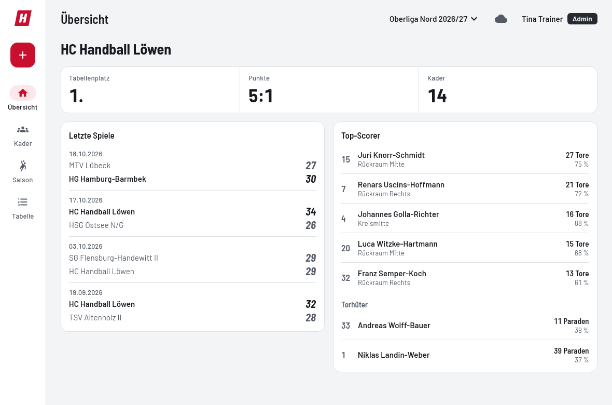 | 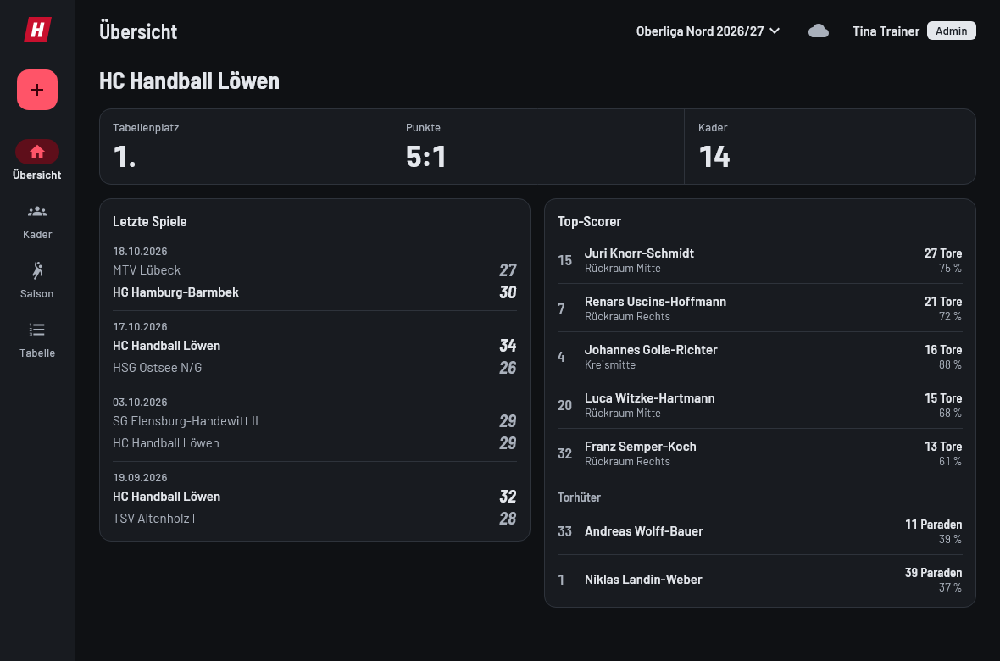 |
| **Spiel mit Aufstellung** | **Kader mit Spielerprofil** |
| 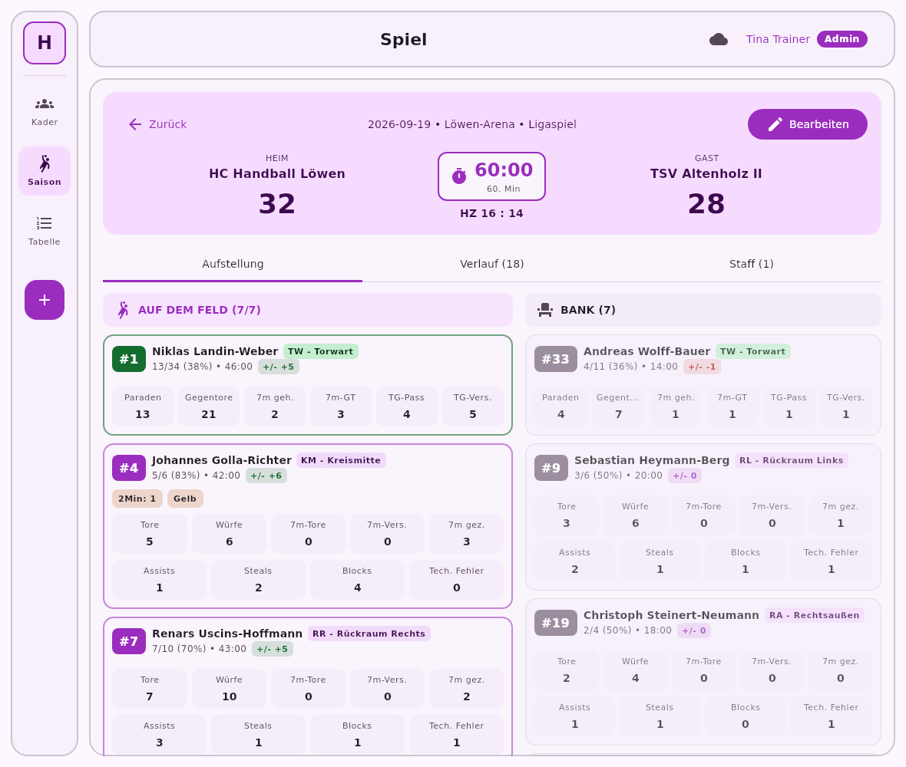 | 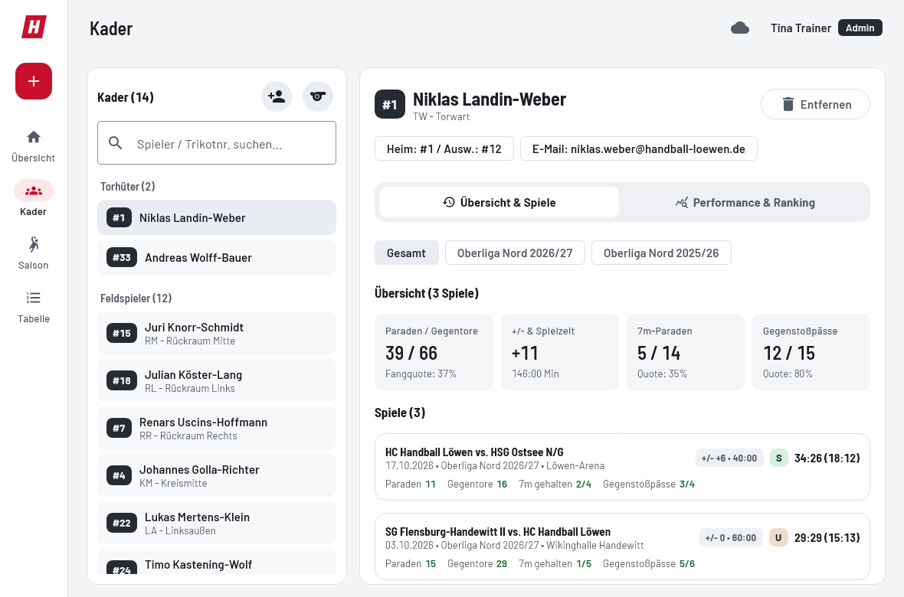 |

**Tabelle**

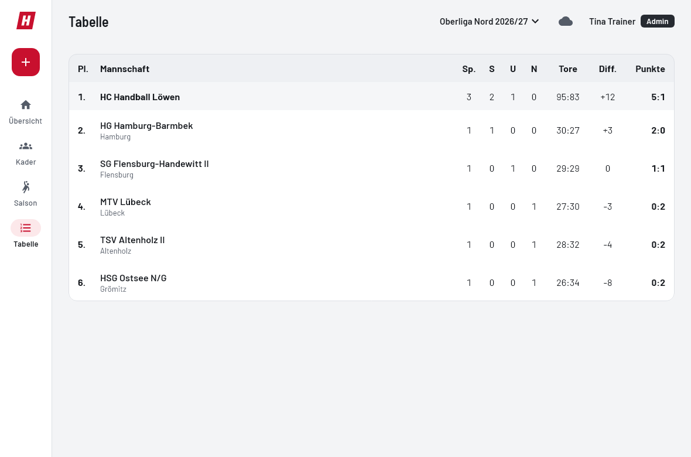

**Handy**

| Übersicht (hell) | Übersicht (dunkel) | Spieler: eigenes Profil |
|---|---|---|
| 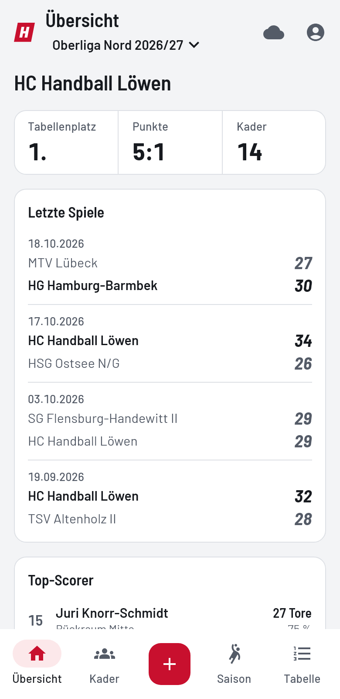 | 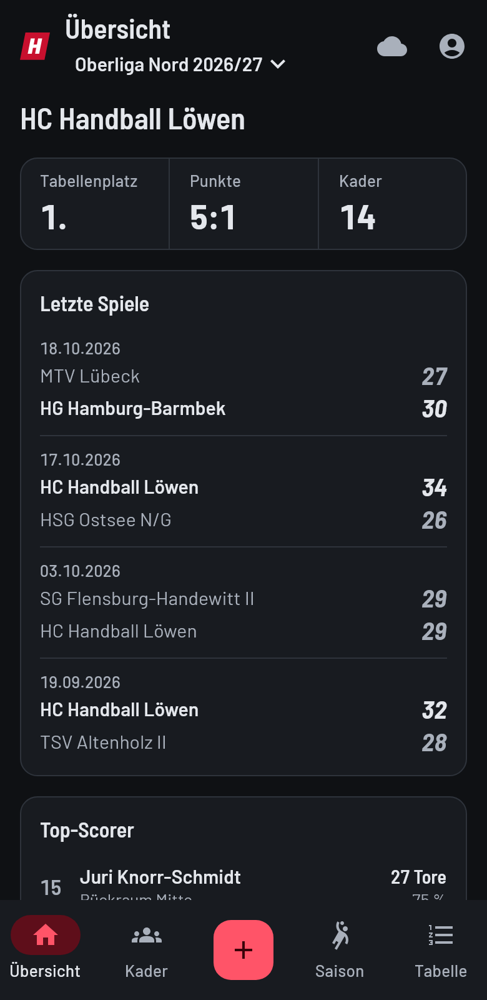 | 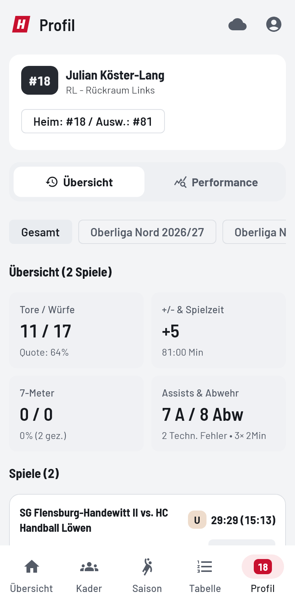 |

**Verwaltung (Admin)**

| Konto | Verein | Benutzer |
|---|---|---|
| 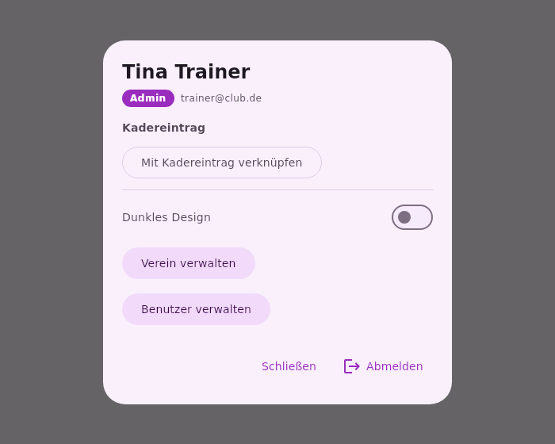 | 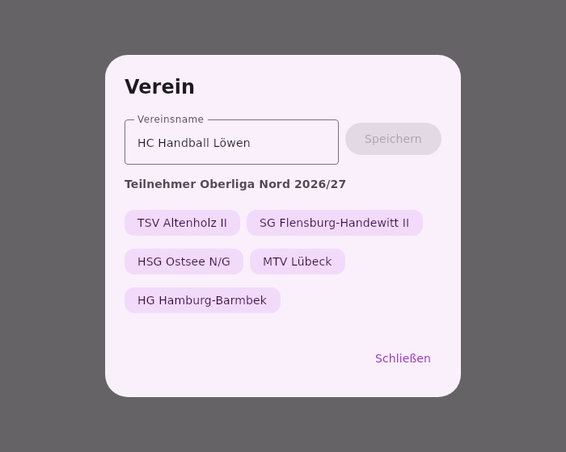 | 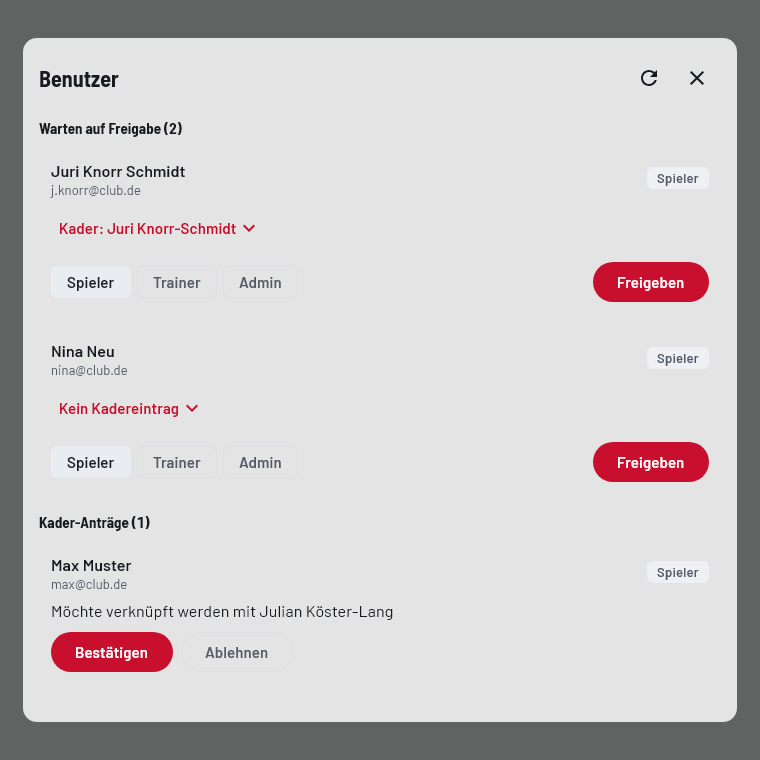 |

Bilder neu erzeugen: `./gradlew :composeApp:updateDocScreenshots` (schreibt nach `docs/screenshots/`).

## Rollen und Konten

| Rolle | Darf |
|---|---|
| Spieler | alles ansehen, nichts ändern; mobil mit Tab "Profil" für das eigene Profil |
| Trainer | zusätzlich Spiele, Statistiken, Kader, Gegner und Saisons bearbeiten, "Verein verwalten" (Vereinsname, Teilnehmer der Saison) |
| Admin | zusätzlich "Benutzer verwalten": Konten freischalten, Rollen ändern, sperren, Kadereinträge verknüpfen |

Das Konto lässt sich auf drei Wegen mit einem Kadereintrag verknüpfen:
1. **Automatisch per E-Mail:** Der Trainer trägt die E-Mail beim Spieler ein, der Spieler registriert sich mit derselben Adresse und bestätigt sie.
2. **Der Admin wählt beim Freigeben** den Kadereintrag (die App schlägt ihn nach Antrag, E-Mail oder Name vor).
3. **Antrag im Konto-Dialog**, den der Admin unter "Kader-Anträge" bestätigt.

Ein neues Konto sieht die Kaderliste erst nach der Freischaltung. Schreibzugriffe erzwingt die Datenbank, nicht die App (siehe `supabase_schema.sql`).

## Einrichten

1. **Supabase-Projekt** anlegen und den Inhalt von [`supabase_schema.sql`](supabase_schema.sql) im SQL-Editor ausführen (idempotent, kann wiederholt werden).
2. **`.env`** aus [`.env.example`](.env.example) kopieren und `SUPABASE_URL` sowie `SUPABASE_PUBLIC_KEY` eintragen. Die Schlüssel werden beim Bauen in die App eingebaut: nur den öffentlichen Schlüssel verwenden, nie einen `sb_secret_`- oder `service_role`-Schlüssel.
3. **Ersten Admin anlegen:** In der App registrieren, dann im SQL-Editor
   ```sql
   UPDATE public.user_profiles SET role = 'ADMIN', status = 'ACTIVE' WHERE email = 'deine@mail.de';
   ```
4. Weitere Personen registrieren sich selbst; der Admin schaltet sie frei (siehe oben).

## Starten

Voraussetzungen: JDK 21 oder neuer; für Android zusätzlich das Android SDK (z. B. über Android Studio).

```bash
./gradlew :composeApp:run                 # Desktop-App
./gradlew :composeApp:assembleDebug       # Android-APK (composeApp/build/outputs/apk/debug)
```
Unter Windows `.\gradlew.bat` statt `./gradlew`. Die APK installierst du mit `adb install -r <datei>.apk` oder durch Kopieren aufs Gerät.

### Web-Version (PWA)

```bash
./gradlew :composeApp:wasmJsBrowserDistribution   # Ergebnis: composeApp/build/dist/wasmJs/productionExecutable
```
Die Web-Version wird bei jedem Push auf `main` automatisch gebaut und auf **GitHub Pages** veröffentlicht ([`.github/workflows/web.yml`](.github/workflows/web.yml)). Einmalig einrichten:
1. Repository → *Settings → Pages → Source*: **GitHub Actions**.
2. *Settings → Secrets and variables → Actions*: `SUPABASE_URL` und `SUPABASE_PUBLIC_KEY` als Secrets anlegen (öffentlicher Schlüssel).
3. In Supabase unter *Authentication → URL Configuration* die Seitenadresse als *Site URL* eintragen, damit Links aus Bestätigungs-Mails dort landen.

Auf dem Handy die Seite öffnen und *Zum Startbildschirm hinzufügen* wählen (Android: Chrome-Menü, iPhone: Safari → Teilen). Die App startet dann im Vollbild und auch ohne Netz. Sie braucht einen aktuellen Browser (Chrome ab ca. 119, Safari ab iOS 18.2), weil sie Kotlin/Wasm nutzt. Die Daten liegen im Browser-Speicher und werden wie in der App mit Supabase abgeglichen.

## Tests

```bash
./gradlew :shared:desktopTest             # Logik: Repository, Login, Rollen, Sync, Speicher
./gradlew :composeApp:desktopTest         # zeichnet die Screens ohne Fenster als PNG nach composeApp/build/screenshots/
```
Die Bilder für dieses README aktualisiert `./gradlew :composeApp:updateDocScreenshots`.

Vollständige Prüfung vor einem Commit: `:shared:compileKotlinDesktop :composeApp:compileKotlinDesktop :shared:desktopTest :composeApp:desktopTest`.

## Projektstruktur

- [`shared`](shared/src): Datenmodell ([`Models.kt`](shared/src/commonMain/kotlin/com/handball/stattracker/model/Models.kt)), SQLDelight-Schema, [`HandballRepository`](shared/src/commonMain/kotlin/com/handball/stattracker/repository/HandballRepository.kt) (Zustand, Regeln, Statistik, Sync), Login ([`AuthRepository`](shared/src/commonMain/kotlin/com/handball/stattracker/repository/AuthRepository.kt)), Benutzerverwaltung ([`AdminRepository`](shared/src/commonMain/kotlin/com/handball/stattracker/repository/AdminRepository.kt)), plattformspezifischer Speicher (`PlatformStorage*`, verschlüsselte Token).
- [`composeApp`](composeApp/src): Oberfläche. [`HandballApp.kt`](composeApp/src/commonMain/kotlin/com/handball/stattracker/ui/HandballApp.kt) ist die Hülle (Seitenleiste ab 700 dp Breite, untere Leiste auf dem Handy), die Bildschirme liegen in [`ui/screens`](composeApp/src/commonMain/kotlin/com/handball/stattracker/ui/screens), das Theme in [`ui/theme`](composeApp/src/commonMain/kotlin/com/handball/stattracker/ui/theme).
- [`supabase_schema.sql`](supabase_schema.sql): Tabellen, Zeilenregeln (RLS), Rollen und die Sync-Funktion. Datenmodell als Diagramm: [`handball-stata-tracker-database-modell.mermaid`](handball-stata-tracker-database-modell.mermaid).

## Stand und Grenzen

- Desktop-Logik und Bildschirme sind getestet. Der **Android-Build und alles Android-Spezifische** (Schlüsselspeicher, Datenumzug) wurden noch nicht auf einem Gerät geprüft; **iOS** ist nicht gebaut (kein Xcode-Projekt, Token noch unverschlüsselt).
- Offen: Einladungscodes in der App erzeugen, Zusammenführen bei gleichzeitiger Offline-Bearbeitung auf zwei Geräten, weiche Übergänge in der Navigation, Passwort-Reset-Link in der Web-Version direkt verarbeiten.

## Weitere Dokumente

- [`AGENT_BRIEFING.md`](AGENT_BRIEFING.md): Entscheidungen, Roadmap und der aktuelle Übergabestand (Abschnitt 6).
- [`CLAUDE.md`](CLAUDE.md): Regeln und Befehle für die Arbeit mit Claude Code.
- [`USER_FEATURE.md`](USER_FEATURE.md): Entwurf des Rollen- und Anmeldekonzepts.
