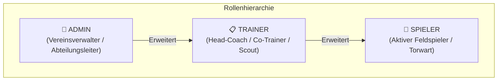
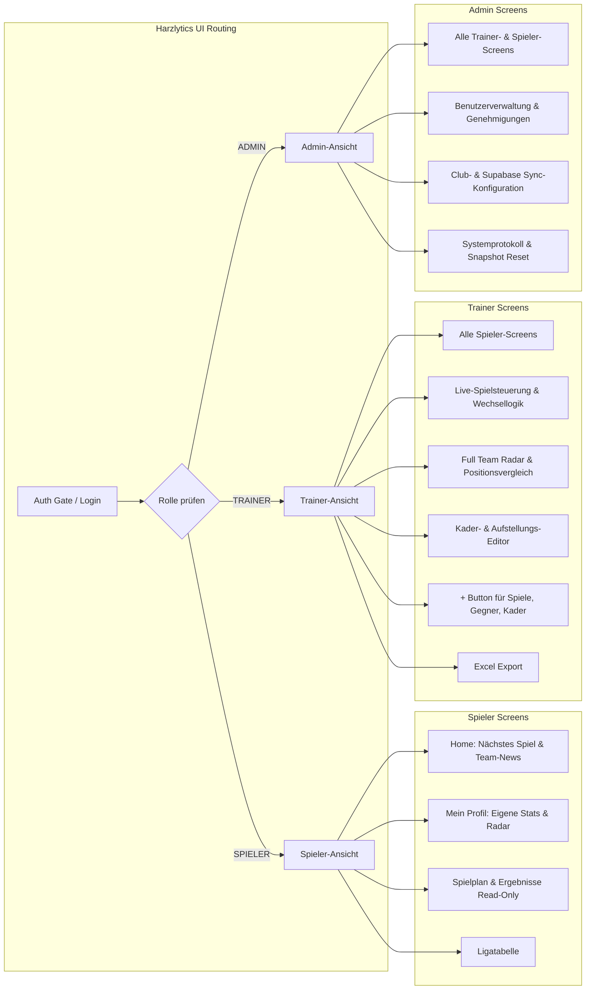
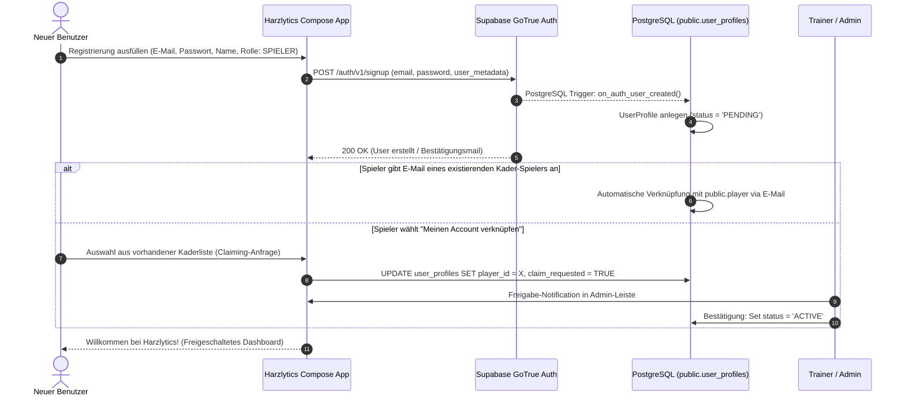
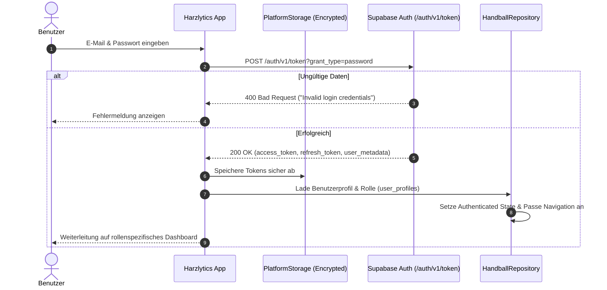
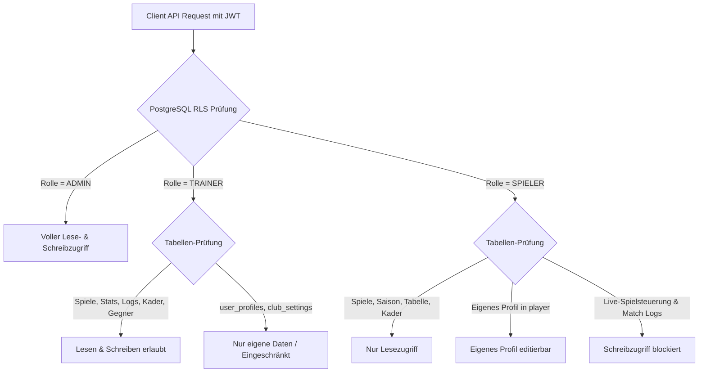
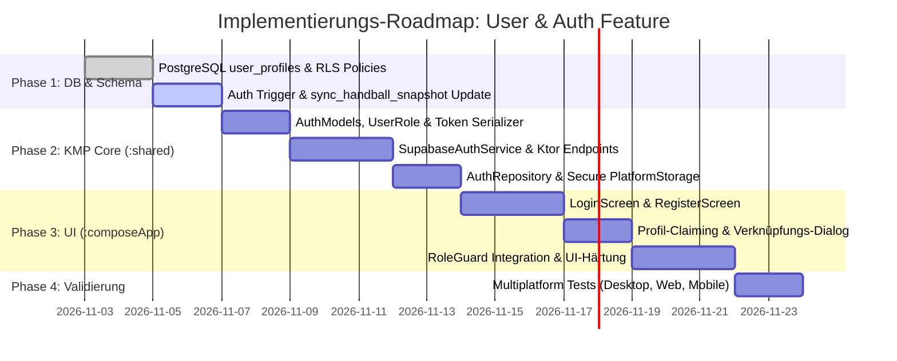

# Feature-Design: Rollenbasierte Benutzer- & Zugriffsberechtigung (RBAC) für Harzlytics

> **Dokumentversion:** 1.0.0  
> **Status:** Entwurf & Spezifikation  
> **Zielsystem:** Harzlytics (Kotlin Multiplatform – Desktop, Web, Android, iOS) mit Supabase Backend  
> **Autoren:** Harzlytics Core Architecture Team  

---

## Inhaltsverzeichnis

1. [Überblick & Zielsetzung](#1-überblick--zielsetzung)
2. [Rollenmodell & Zugriffsberechtigungs-Matrix (RBAC)](#2-rollenmodell--zugriffsberechtigungs-matrix-rbac)
   - [2.1 Die drei Kernrollen](#21-die-drei-kernrollen)
   - [2.2 Detaillierte Rechte-Matrix nach Entitäten](#22-detaillierte-rechte-matrix-nach-entitäten)
   - [2.3 Aufteilung der Applikationsbereiche pro Rolle](#23-aufteilung-der-applikationsbereiche-pro-rolle)
3. [Authentifizierungs- & Registrierungs-Workflows](#3-authentifizierungs--registrierungs-workflows)
   - [3.1 Registrierungs-Flow & Spieler-Verknüpfung (Claiming)](#31-registrierungs-flow--spieler-verknüpfung-claiming)
   - [3.2 Login-Flow & Session-Lifecycle](#32-login-flow--session-lifecycle)
   - [3.3 Passwort-Wiederherstellung & Logout](#33-passwort-wiederherstellung--logout)
   - [3.4 Offline-First & Multiplatform Token-Storage](#34-offline-first--multiplatform-token-storage)
4. [Supabase-Integration & Backend-Design](#4-supabase-integration--backend-design)
   - [4.1 PostgreSQL Schema-Erweiterungen (`user_profiles`, `invitations`)](#41-postgresql-schema-erweiterungen-user_profiles-invitations)
   - [4.2 Auth Trigger & Hilfsfunktionen in PL/pgSQL](#42-auth-trigger--hilfsfunktionen-in-plpgsql)
   - [4.3 Row Level Security (RLS) Policies](#43-row-level-security-rls-policies)
   - [4.4 Absicherung der Snapshot-Synchronisation (`sync_handball_snapshot`)](#44-absicherung-der-snapshot-synchronisation-sync_handball_snapshot)
5. [Client-Architektur (Kotlin Multiplatform & Compose)](#5-client-architektur-kotlin-multiplatform--compose)
   - [5.1 Datenmodelle (`:shared`)](#51-datenmodelle-shared)
   - [5.2 `SupabaseAuthService` (Ktor REST Client)](#52-supabaseauthservice-ktor-rest-client)
   - [5.3 `AuthRepository` & Zustandsverwaltung](#53-authrepository--zustandsverwaltung)
   - [5.4 UI-Architektur & Dekorative RoleGuards (`:composeApp`)](#54-ui-architektur--dekorative-roleguards-composeapp)
   - [5.5 Integration in Shell & Navigation (`HandballApp.kt`)](#55-integration-in-shell--navigation-handballappkt)
6. [Sicherheitskonzept, Datenschutz & Zero Trust](#6-sicherheitskonzept-datenschutz--zero-trust)
7. [Schritt-für-Schritt Implementierungs-Roadmap](#7-schritt-für-schritt-implementierungs-roadmap)

---

## 1. Überblick & Zielsetzung

Harzlytics bietet derzeit ein vollständiges, Offline-First-fähiges Statistik-, Aufstellungs- und Analyse-System für den Handballsport. Die Datensynchronisation erfolgt über einen zentralen Snapshot mit PostgreSQL auf Supabase.

Mit diesem Feature erhält Harzlytics eine vollwertige **Benutzeranbindung mit rollenbasierter Zugriffskontrolle (Role-Based Access Control, RBAC)** unter Nutzung des bestehenden Supabase-Ökosystems (`GoTrue Auth` + PostgreSQL `Row Level Security`).

### Kernziele:
1. **Sichere Registrierung & Login:** Nahtlose Integration mit Supabase Auth (E-Mail & Passwort, JWT Session Tokens, automatische Token-Erneuerung).
2. **Dreistufiges Rollenmodell:**
   - **`Spieler`**: Fokus auf das eigene Leistungsprofil, Team-Spielplan, Tabelle und persönliche Entwicklungsstatistiken (Read-Only für Spieldaten & Taktik).
   - **`Trainer`**: Volle Spieltags- & Aufstellungs-Kontrolle, Live-Ticker-Bedienung, 2-Klick-Wechsellogik, Kader- und Gegnerverwaltung, Performance-Vergleiche und Excel-Exporte.
   - **`Admin`**: Club-Administration, Benutzerverwaltung (Rollenvergabe, Einladungen/Freigaben), Vereinsstammdaten, System- und Supabase-Konfiguration.
3. **Nahtlose Rückwärtskompatibilität:** Der bestehende Offline-First-Mechanismus (SQLDelight / LocalStorage / JSON-Snapshot) bleibt erhalten, wird jedoch rollenspezifisch autorisiert und serverseitig über PostgreSQL RLS abgesichert.
4. **Smarte Spieler-Verknüpfung (Profile Claiming):** Spieler können ihren registrierten Account mit einem bereits vom Trainer im Kader angelegten Profil (`public.player`) verknüpfen.

---

## 2. Rollenmodell & Zugriffsberechtigungs-Matrix (RBAC)

### 2.1 Die drei Kernrollen



1. **`SPIELER` (Player):**
   - **Fokus:** Eigene Leistungsentwicklung, Vorbereitung auf kommende Spiele, Teaminformationen.
   - **Lesezugriff:** Öffentlicher Spielplan, Ligatabelle, Kaderübersicht, eigene historische Spielstatistiken, persönliches Performance-Radar.
   - **Schreibzugriff:** Nur eigene Kontaktdaten und Profilinformationen. Keine Bearbeitung von Spielständen, Aufstellungen oder Kaderlisten.

2. **`TRAINER` (Coach):**
   - **Fokus:** Spielvorbereitung, Live-Match-Coaching, Taktik, Teamanalyse.
   - **Lesezugriff:** Vollständiger Einblick in alle Team- und Spielerdaten, Quoten, Formkurven, Torverläufe und Gegnerstatistiken.
   - **Schreibzugriff:** Anlegen und Bearbeiten von Spielen, Live-Erfassung von Aktionen (Tore, Paraden, Strafen, Auszeiten), 2-Klick-Spielerwechsel, Start-7-Konfiguration, Kaderpflege (Spieler anlegen/bearbeiten).
   - **Einschränkung:** Keine Berechtigung zur Vergabe administrativer Systemrollen oder Änderung von Supabase-Keys.

3. **`ADMIN` (Administrator):**
   - **Fokus:** Vereinsorganisation, Systemintegrität und Mandantenverwaltung.
   - **Lesezugriff:** Vollzugriff auf alle Datenbereiche.
   - **Schreibzugriff:** Benutzerfreigabe, Zuweisung von Rollen (`Spieler`, `Trainer`, `Admin`), Vereinsname & Club-Settings, API- & Sync-Konfiguration, Daten-Import/Export und Bereinigung.

---

### 2.2 Detaillierte Rechte-Matrix nach Entitäten

| Entität / Bereich | Spieler | Trainer | Admin |
| :--- | :---: | :---: | :---: |
| **Kader / Spieler anlegen & löschen** | ❌ Nein | ✅ Ja | ✅ Ja |
| **Kaderliste einsehen** | ✅ Ja (Read-Only) | ✅ Ja | ✅ Ja |
| **Eigenes Spielerprofil bearbeiten** | ✅ Ja (E-Mail, Trikot) | ✅ Ja | ✅ Ja |
| **Fremde Spielerprofile bearbeiten** | ❌ Nein | ✅ Ja | ✅ Ja |
| **Performance-Radar aller Spieler** | ⚠️ Eingeschränkt (nur Team-Durchschnitt) | ✅ Ja (Vollständig) | ✅ Ja |
| **Eigenes Performance-Radar** | ✅ Ja | ✅ Ja | ✅ Ja |
| **Start-7 & Aufstellungsplaner** | 👁️ Nur Aufstellung ansehen | ✏️ Vollständig bearbeiten | ✏️ Vollständig bearbeiten |
| **Live-Spieluhr & Spielereinwechslung** | ❌ Gesperrt | ✅ Vollständig | ✅ Vollständig |
| **Statistik-Stepper (+/- Tore/Paraden)** | ❌ Gesperrt | ✅ Vollständig | ✅ Vollständig |
| **Spiele & Spieltermine anlegen/ändern**| ❌ Nein | ✅ Ja | ✅ Ja |
| **Ligagegner anlegen & verwalten** | ❌ Nein | ✅ Ja | ✅ Ja |
| **Saisons anlegen & verwalten** | ❌ Nein | ✅ Ja | ✅ Ja |
| **Excel-Export von Spiel- & Saisondaten**| ❌ Nein | ✅ Ja | ✅ Ja |
| **Benutzerverwaltung & Rollenvergabe** | ❌ Nein | ❌ Nein | ✅ Ja |
| **Vereinsname & System-Sync Config** | ❌ Nein | ❌ Nein | ✅ Ja |

---

### 2.3 Aufteilung der Applikationsbereiche pro Rolle

Die Benutzeroberfläche in `composeApp` passt sich dynamisch an die eingeloggte Rolle an:



#### Detailbeschreibung der Screens:

1. **Bereich „Home“ (`DashboardScreen.kt`)**:
   - *Spieler*: Sieht Countdown zum nächsten Spiel, den aktuellen Tabellenplatz des Teams sowie die eigenen Leistungsdaten des letzten Spiels.
   - *Trainer*: Sieht zusätzlich Trainingsbeteiligung, offene Spielberichte, Schnellzugriff auf die Aufstellung und Live-Spielerfassung.
   - *Admin*: Sieht zusätzlich Status-Karten zur Benutzerregistrierung (z. B. *"2 neue Spieler warten auf Freigabe"*), Supabase-Verbindungsstatus und Datenbanksynchronisation.

2. **Bereich „Kader & Performance“ (`RosterScreen.kt` & `PlayerPerformanceTab.kt`)**:
   - *Spieler*: Default-Auswahl ist sofort das **eigene Profil**. Das 6-Achsen-Radar und die Formkurve zeigen die eigene Entwicklung im Vergleich zum Liga- und Positionsdurchschnitt. Der Bearbeitungs-Stift und der „Spieler hinzufügen“-Button sind ausgeblendet.
   - *Trainer & Admin*: Vollständige Kaderliste mit Such- & Filterfunktion, Stepper zum Zuweisen von Trikotnummern, Positionsvergleich, Starting-7-Optimierer und Erfassungsdialoge.

3. **Bereich „Saison & Spieltags-Dashboard“ (`SeasonScreen.kt`)**:
   - *Spieler*: Ansicht des Spielplans, Endergebnisse, Halbzeitstände, Torverlauf-Graph (`+3/0/-3`) und das chronologische Spielprotokoll im Tab „Verlauf & Protokoll“. Die Side-by-Side-Wechselspalten sind rein informativ; Stepper und Wechsel-Klicks sind deaktiviert.
   - *Trainer & Admin*: Vollständige Live-Steuerung:
     - 2-Klick-Spielerwechsel (`6 Feld + 1 TW` bzw. `7 Feld + 0 TW` Validierung).
     - Live-Spieluhr (Start, Stopp, 2-Minuten-Strafzeit-Countdown).
     - In-Game Action Stepper (+/- Tore, 7m, Paraden, Verwarnungen, Hinausstellungen).

4. **Bereich „Aktionen & Erstellung“ (`PlusCreationDialogs.kt`)**:
   - *Spieler*: Der globale `+`-Button in der Navigation ist **deaktiviert oder ausgeblendet**.
   - *Trainer*: Zugriff auf: „Neuer Spieler“, „Neues Spiel“, „Neuer Gegner“, „Excel-Export“.
   - *Admin*: Uneingeschränkter Zugriff inkl. „Benutzer einladen“, „Vereinsprofil anpassen“ und „Datenbank-Snapshot zurücksetzen“.

---

## 3. Authentifizierungs- & Registrierungs-Workflows

### 3.1 Registrierungs-Flow & Spieler-Verknüpfung (Claiming)

Da Trainer den Kader in der Regel vorab im System anlegen (Vorname, Nachname, Position, Trikotnummer), dürfen bei der Benutzerregistrierung keine doppelten Spielerdatensätze entstehen. Das System unterstützt daher das **Profil-Claiming**:



#### Registrierungs-Felder:
- **E-Mail-Adresse** (Eindeutiger Login-Identifier)
- **Passwort** (Mind. 8 Zeichen, mind. 1 Zahl, 1 Großbuchstabe)
- **Vollständiger Name** (Vorname & Nachname)
- **Gewünschte Rolle:**
  - `SPIELER` (Standard): Kann direkt mit einem Spielereintrag des Kaders verknüpft werden.
  - `TRAINER`: Benötigt einen **Vereins-Einladungscode** oder die Freigabe durch den Admin.
  - `ADMIN`: Kann nur über einen speziellen Master-Code oder die Supabase-Konsole initial generiert werden.

---

### 3.2 Login-Flow & Session-Lifecycle



#### Automatische Token-Erneuerung (Silent Refresh):
Supabase JWTs laufen standardmäßig nach 3600 Sekunden (1 Stunde) ab. Der KMP HTTP-Client implementiert einen automatischen Refresh-Interceptor:
1. Bei einem `401 Unauthorized` auf Backend-Ressourcen oder proaktiv 5 Minuten vor Token-Ablauf wird `POST /auth/v1/token?grant_type=refresh_token` aufgerufen.
2. Nach erfolgreichem Refresh werden die neuen Tokens in `PlatformStorage` abgelegt und die fehlgeschlagene Anfrage erneut ausgeführt.
3. Scheitert der Refresh (z. B. Account gesperrt), wird die lokale Session bereinigt und der Login-Screen angezeigt.

---

### 3.3 Passwort-Wiederherstellung & Logout

- **Passwort vergessen:**
  - Screen bietet „Passwort vergessen?“-Dialog.
  - Aufruf von `POST /auth/v1/recover` mit Angabe der E-Mail-Adresse.
  - Supabase versendet eine E-Mail mit einem Reset-Link bzw. 6-stelligen OTP-Token.
- **Logout:**
  - Aufruf von `POST /auth/v1/logout` mit aktuellem `Bearer Token`.
  - Bereinigung der lokalen Tokens aus `PlatformStorage`.
  - Zurücksetzen des `HandballRepository`-Zustands auf unauthentifizierten Gast- oder Login-Modus.

---

### 3.4 Offline-First & Multiplatform Token-Storage

Harzlytics ist eine Multiplatform-Anwendung. Die sensiblen JWTs (`access_token` und `refresh_token`) sowie das zwischengespeicherte Profil werden über das bestehende `PlatformStorage`-Pattern plattformspezifisch abgesichert:

| Plattform | Speicher-Technologie | Sicherheitsniveau |
| :--- | :--- | :--- |
| **Desktop (JVM)** | Java Keyring / Protected File (`~/.handball-stat-tracker/session.enc`) | Verschlüsselt mit plattformspezifischem HW-Seed |
| **Web (Browser)** | Web Storage (`localStorage` mit In-Memory Token Caching) | Standard HTML5 Storage mit XSS-Vorsichtsmaßnahmen |
| **Android** | `EncryptedSharedPreferences` (AndroidX Security Crypto) | Hardware-backed Keystore |
| **iOS** | iOS Keychain Services (`kSecClassGenericPassword`) | Apple Secure Enclave |

**Offline-Resilienz:**  
Wenn die App offline gestartet wird (z. B. in einer Handballhalle ohne Mobilfunkempfang), nutzt die App die zuletzt gültige, lokal gecachte Session. Der Trainer kann uneingeschränkt Spiele tracken und Auswechslungen vornehmen. Sobald wieder Netz verfügbar ist, werden die Daten synchronisiert und das Token bei Bedarf erneuert.

---

## 4. Supabase-Integration & Backend-Design

### 4.1 PostgreSQL Schema-Erweiterungen (`user_profiles`, `invitations`)

Die bestehende Datei `supabase_schema.sql` wird um die Tabellen `user_profiles` und `club_invitations` erweitert. `user_profiles` dient als Bindeglied zwischen Supabase `auth.users` und der fachlichen Tabelle `public.player`.

```sql
-- =============================================================================
-- ERWEITERUNG: BENUTZERVERWALTUNG & ROLLEN (RBAC)
-- =============================================================================

-- 1. ROLLEN-ENUM TYP
DO $$ BEGIN
    CREATE TYPE public.app_role AS ENUM ('SPIELER', 'TRAINER', 'ADMIN');
EXCEPTION
    WHEN duplicate_object THEN null;
END $$;

-- 2. BENUTZERPROFIL-TABELLE
CREATE TABLE IF NOT EXISTS public.user_profiles (
    id UUID PRIMARY KEY REFERENCES auth.users(id) ON DELETE CASCADE,
    email TEXT NOT NULL UNIQUE,
    full_name TEXT NOT NULL DEFAULT '',
    role public.app_role NOT NULL DEFAULT 'SPIELER',
    player_id INTEGER REFERENCES public.player(player_id) ON DELETE SET NULL,
    status TEXT NOT NULL DEFAULT 'ACTIVE' CHECK (status IN ('PENDING', 'ACTIVE', 'SUSPENDED')),
    created_at TIMESTAMPTZ NOT NULL DEFAULT NOW(),
    updated_at TIMESTAMPTZ NOT NULL DEFAULT NOW()
);

-- Index für schnelle Abfragen über player_id und email
CREATE INDEX IF NOT EXISTS idx_user_profiles_player_id ON public.user_profiles(player_id);
CREATE INDEX IF NOT EXISTS idx_user_profiles_email ON public.user_profiles(email);

-- 3. EINLADUNGS- & REGISTRIERUNGSCODES (für Trainer & Spieler)
CREATE TABLE IF NOT EXISTS public.club_invitations (
    invitation_id INTEGER GENERATED BY DEFAULT AS IDENTITY PRIMARY KEY,
    invite_code TEXT NOT NULL UNIQUE,
    intended_role public.app_role NOT NULL,
    player_id INTEGER REFERENCES public.player(player_id) ON DELETE CASCADE,
    max_uses INTEGER NOT NULL DEFAULT 1,
    uses_count INTEGER NOT NULL DEFAULT 0,
    expires_at TIMESTAMPTZ,
    created_by UUID REFERENCES auth.users(id) ON DELETE SET NULL,
    created_at TIMESTAMPTZ NOT NULL DEFAULT NOW()
);
```

---

### 4.2 Auth Trigger & Hilfsfunktionen in PL/pgSQL

Damit bei jeder Registrierung über Supabase Auth automatisch ein Eintrag in `public.user_profiles` angelegt wird, wird ein PostgreSQL-Trigger auf `auth.users` eingerichtet.

```sql
-- Automatische Profil-Erstellung beim Signup
CREATE OR REPLACE FUNCTION public.handle_new_user()
RETURNS TRIGGER
LANGUAGE plpgsql
SECURITY DEFINER
SET search_path = public
AS $$
DECLARE
    assigned_role public.app_role;
    linked_player_id INTEGER;
    user_fullname TEXT;
BEGIN
    -- Metadaten aus dem GoTrue Auth Request auslesen
    user_fullname := COALESCE(new.raw_user_meta_data->>'full_name', '');
    
    -- Rolle bestimmen (Default SPIELER; TRAINER nur falls durch Invite/Admin bestätigt)
    assigned_role := CASE 
        WHEN new.raw_user_meta_data->>'role' = 'TRAINER' THEN 'TRAINER'::public.app_role
        WHEN new.raw_user_meta_data->>'role' = 'ADMIN' THEN 'ADMIN'::public.app_role
        ELSE 'SPIELER'::public.app_role
    END;

    -- Versuche, automatisch einen existierenden Spieler via E-Mail zu verknüpfen
    SELECT player_id INTO linked_player_id
    FROM public.player
    WHERE LOWER(email) = LOWER(new.email)
    LIMIT 1;

    INSERT INTO public.user_profiles (id, email, full_name, role, player_id, status)
    VALUES (
        new.id,
        new.email,
        user_fullname,
        assigned_role,
        linked_player_id,
        'ACTIVE'
    )
    ON CONFLICT (id) DO UPDATE
    SET email = EXCLUDED.email,
        full_name = EXCLUDED.full_name;

    RETURN NEW;
END;
$$;

-- Trigger aktivieren
DROP TRIGGER IF EXISTS on_auth_user_created ON auth.users;
CREATE TRIGGER on_auth_user_created
    AFTER INSERT ON auth.users
    FOR EACH ROW EXECUTE FUNCTION public.handle_new_user();

-- Hilfsfunktionen zur schnellen Rollenprüfung in RLS
CREATE OR REPLACE FUNCTION public.current_user_role()
RETURNS public.app_role
LANGUAGE sql
STABLE
SECURITY DEFINER
AS $$
    SELECT role FROM public.user_profiles WHERE id = auth.uid();
$$;

CREATE OR REPLACE FUNCTION public.current_player_id()
RETURNS INTEGER
LANGUAGE sql
STABLE
SECURITY DEFINER
AS $$
    SELECT player_id FROM public.user_profiles WHERE id = auth.uid();
$$;

CREATE OR REPLACE FUNCTION public.is_admin()
RETURNS BOOLEAN
LANGUAGE sql
STABLE
SECURITY DEFINER
AS $$
    SELECT (public.current_user_role() = 'ADMIN');
$$;

CREATE OR REPLACE FUNCTION public.is_coach_or_admin()
RETURNS BOOLEAN
LANGUAGE sql
STABLE
SECURITY DEFINER
AS $$
    SELECT (public.current_user_role() IN ('TRAINER', 'ADMIN'));
$$;
```

---

### 4.3 Row Level Security (RLS) Policies

Die pauschale Entwickler-Policy `CREATE POLICY "Allow access for app sync" ... USING (true)` wird durch granulare, rollenbasierte Richtlinien ersetzt:



#### SQL-Sicherheitsregeln:

```sql
-- RLS auf allen Tabellen aktivieren
ALTER TABLE public.user_profiles ENABLE ROW LEVEL SECURITY;
ALTER TABLE public.club_invitations ENABLE ROW LEVEL SECURITY;
ALTER TABLE public.player ENABLE ROW LEVEL SECURITY;
ALTER TABLE public.game ENABLE ROW LEVEL SECURITY;
ALTER TABLE public.player_game ENABLE ROW LEVEL SECURITY;
ALTER TABLE public.field_player_gamestats ENABLE ROW LEVEL SECURITY;
ALTER TABLE public.goal_keeper_gamestats ENABLE ROW LEVEL SECURITY;
ALTER TABLE public.game_log ENABLE ROW LEVEL SECURITY;
ALTER TABLE public.season ENABLE ROW LEVEL SECURITY;
ALTER TABLE public.opponent_teams ENABLE ROW LEVEL SECURITY;
ALTER TABLE public.app_snapshots ENABLE ROW LEVEL SECURITY;

-- 1. USER_PROFILES
CREATE POLICY "Users can read all profiles"
    ON public.user_profiles FOR SELECT
    TO authenticated USING (true);

CREATE POLICY "Users can update own profile"
    ON public.user_profiles FOR UPDATE
    TO authenticated
    USING (id = auth.uid())
    WITH CHECK (id = auth.uid());

CREATE POLICY "Admins have full access on profiles"
    ON public.user_profiles FOR ALL
    TO authenticated
    USING (public.is_admin());

-- 2. KADER / PLAYER
CREATE POLICY "Anyone authenticated can view players"
    ON public.player FOR SELECT
    TO authenticated USING (true);

CREATE POLICY "Coaches and Admins can insert/update players"
    ON public.player FOR ALL
    TO authenticated
    USING (public.is_coach_or_admin())
    WITH CHECK (public.is_coach_or_admin());

CREATE POLICY "Players can update their own player entry"
    ON public.player FOR UPDATE
    TO authenticated
    USING (player_id = public.current_player_id())
    WITH CHECK (player_id = public.current_player_id());

-- 3. SPIELE, GAME_LOGS & STATISTIKEN
CREATE POLICY "Anyone authenticated can read games and stats"
    ON public.game FOR SELECT TO authenticated USING (true);
CREATE POLICY "Anyone authenticated can read player_game"
    ON public.player_game FOR SELECT TO authenticated USING (true);
CREATE POLICY "Anyone authenticated can read game_log"
    ON public.game_log FOR SELECT TO authenticated USING (true);
CREATE POLICY "Anyone authenticated can read stats"
    ON public.field_player_gamestats FOR SELECT TO authenticated USING (true);
CREATE POLICY "Anyone authenticated can read gk_stats"
    ON public.goal_keeper_gamestats FOR SELECT TO authenticated USING (true);

-- Schreibzugriff auf Spiele & Live-Daten nur für TRAINER und ADMIN
CREATE POLICY "Coaches and Admins can manage games"
    ON public.game FOR ALL
    TO authenticated
    USING (public.is_coach_or_admin())
    WITH CHECK (public.is_coach_or_admin());

CREATE POLICY "Coaches and Admins can manage player_game"
    ON public.player_game FOR ALL
    TO authenticated
    USING (public.is_coach_or_admin())
    WITH CHECK (public.is_coach_or_admin());

CREATE POLICY "Coaches and Admins can manage game_logs"
    ON public.game_log FOR ALL
    TO authenticated
    USING (public.is_coach_or_admin())
    WITH CHECK (public.is_coach_or_admin());

CREATE POLICY "Coaches and Admins can manage field player stats"
    ON public.field_player_gamestats FOR ALL
    TO authenticated
    USING (public.is_coach_or_admin())
    WITH CHECK (public.is_coach_or_admin());

CREATE POLICY "Coaches and Admins can manage goalkeeper stats"
    ON public.goal_keeper_gamestats FOR ALL
    TO authenticated
    USING (public.is_coach_or_admin())
    WITH CHECK (public.is_coach_or_admin());
```

---

### 4.4 Absicherung der Snapshot-Synchronisation (`sync_handball_snapshot`)

Die bestehende RPC-Funktion `sync_handball_snapshot` wird angepasst: Spieler dürfen den Snapshot abrufen (Read-Sync), das Überschreiben und Spiegeln der relationalen Tabellen ist jedoch zwingend an die Rolle `TRAINER` oder `ADMIN` gebunden:

```sql
CREATE OR REPLACE FUNCTION public.sync_handball_snapshot(incoming_snapshot JSONB)
RETURNS JSONB
LANGUAGE plpgsql
SECURITY DEFINER
SET search_path = public
AS $$
DECLARE
    existing_record public.app_snapshots%ROWTYPE;
    incoming_ts BIGINT;
    incoming_club TEXT;
    caller_role public.app_role;
BEGIN
    -- Ermittle die Rolle des aufrufenden Nutzers
    caller_role := public.current_user_role();
    
    -- 1. Lese aktuellen Stand aus
    SELECT * INTO existing_record
    FROM public.app_snapshots
    WHERE snapshot_key = 'default'
    FOR UPDATE;

    -- 2. Wenn der Aufrufer ein SPIELER ist oder keine Schreibberechtigung hat:
    -- Spieler dürfen NIEMALS den Server-Snapshot überschreiben, sondern erhalten immer den Server-Stand!
    IF caller_role = 'SPIELER' OR caller_role IS NULL THEN
        IF FOUND THEN
            RETURN existing_record.payload;
        ELSE
            RETURN incoming_snapshot;
        END IF;
    END IF;

    -- 3. Für TRAINER und ADMIN: Normale Snapshot-Sync-Logik
    incoming_ts := COALESCE((incoming_snapshot->>'lastUpdatedEpochMillis')::BIGINT, 0);
    incoming_club := COALESCE(incoming_snapshot->>'ownClubName', 'HC Handball Löwen');

    IF FOUND AND existing_record.last_updated_epoch_millis > incoming_ts THEN
        RETURN existing_record.payload;
    END IF;

    -- Lokaler Snapshot des Trainers/Admins ist neuer: Speichern und relational spiegeln
    INSERT INTO public.app_snapshots (snapshot_key, own_club_name, last_updated_epoch_millis, payload, updated_at)
    VALUES ('default', incoming_club, incoming_ts, incoming_snapshot, NOW())
    ON CONFLICT (snapshot_key) DO UPDATE
    SET own_club_name = EXCLUDED.own_club_name,
        last_updated_epoch_millis = EXCLUDED.last_updated_epoch_millis,
        payload = EXCLUDED.payload,
        updated_at = NOW();

    -- Relationale Tabellen spiegeln (wie bisher in supabase_schema.sql)
    -- ... [Bestehender DELETE & INSERT-Block für die 12 Tabellen] ...

    RETURN incoming_snapshot;
END;
$$;
```

---

## 5. Client-Architektur (Kotlin Multiplatform & Compose)

### 5.1 Datenmodelle (`:shared`)

In `shared/src/commonMain/kotlin/com/handball/stattracker/model/AuthModels.kt` werden die Authentifizierungs- und Benutzerstrukturen definiert:

```kotlin
package com.handball.stattracker.model

import kotlinx.serialization.SerialName
import kotlinx.serialization.Serializable

@Serializable
enum class UserRole(val label: String, val badgeColorHex: Long) {
    @SerialName("SPIELER")
    SPIELER("Spieler", 0xFF2E7D32), // Sportliches Grün

    @SerialName("TRAINER")
    TRAINER("Trainer", 0xFF1565C0), // Taktisches Blau

    @SerialName("ADMIN")
    ADMIN("Administrator", 0xFFC62828) // Markantes Rot
}

@Serializable
data class UserProfile(
    val id: String,
    val email: String,
    val fullName: String,
    val role: UserRole,
    val playerId: Int? = null,
    val status: String = "ACTIVE"
) {
    val isPlayer: Boolean get() = role == UserRole.SPIELER
    val isCoach: Boolean get() = role == UserRole.TRAINER
    val isAdmin: Boolean get() = role == UserRole.ADMIN
    val canEditLiveGame: Boolean get() = role == UserRole.TRAINER || role == UserRole.ADMIN
    val canManageRoster: Boolean get() = role == UserRole.TRAINER || role == UserRole.ADMIN
    val canConfigureSystem: Boolean get() = role == UserRole.ADMIN
}

@Serializable
data class AuthTokens(
    @SerialName("access_token") val accessToken: String,
    @SerialName("refresh_token") val refreshToken: String,
    @SerialName("expires_in") val expiresIn: Long = 3600
)

sealed interface AuthState {
    data object Loading : AuthState
    data object Unauthenticated : AuthState
    data class Authenticated(val profile: UserProfile, val tokens: AuthTokens) : AuthState
    data class Error(val message: String) : AuthState
}
```

---

### 5.2 `SupabaseAuthService` (Ktor REST Client)

Die Kommunikation mit den Supabase GoTrue Auth REST-Endpunkten (`/auth/v1/`) erfolgt direkt über Ktor Client ohne schwere Drittanbieter-Bibliotheken:

```kotlin
package com.handball.stattracker.repository

import com.handball.stattracker.config.SupabaseConfig
import com.handball.stattracker.model.*
import io.ktor.client.*
import io.ktor.client.call.*
import io.ktor.client.request.*
import io.ktor.client.statement.*
import io.ktor.http.*
import kotlinx.serialization.json.*

class SupabaseAuthService(
    private val httpClient: HttpClient
) {
    private val baseUrl: String get() = SupabaseConfig.resolvedProjectUrl()
    private val apiKey: String get() = SupabaseConfig.resolvedApiKey()

    suspend fun signUp(
        email: String,
        password: String,
        fullName: String,
        role: UserRole,
        inviteCode: String? = null
    ): Result<AuthTokens> = runCatching {
        val response = httpClient.post("$baseUrl/auth/v1/signup") {
            header("apikey", apiKey)
            contentType(ContentType.Application.Json)
            setBody(buildJsonObject {
                put("email", email)
                put("password", password)
                putJsonObject("data") {
                    put("full_name", fullName)
                    put("role", role.name)
                    if (!inviteCode.isNullOrBlank()) {
                        put("invite_code", inviteCode)
                    }
                }
            })
        }
        if (!response.status.isSuccess()) {
            val errorBody = response.bodyAsText()
            throw IllegalStateException("Registrierung fehlgeschlagen: $errorBody")
        }
        response.body<AuthTokens>()
    }

    suspend fun signInWithPassword(
        email: String,
        password: String
    ): Result<AuthTokens> = runCatching {
        val response = httpClient.post("$baseUrl/auth/v1/token?grant_type=password") {
            header("apikey", apiKey)
            contentType(ContentType.Application.Json)
            setBody(buildJsonObject {
                put("email", email)
                put("password", password)
            })
        }
        if (!response.status.isSuccess()) {
            throw IllegalStateException("Ungültige Anmeldedaten oder Benutzer nicht gefunden.")
        }
        response.body<AuthTokens>()
    }

    suspend fun fetchUserProfile(accessToken: String): Result<UserProfile> = runCatching {
        val response = httpClient.get("$baseUrl/rest/v1/user_profiles") {
            parameter("select", "*")
            header("apikey", apiKey)
            header(HttpHeaders.Authorization, "Bearer $accessToken")
        }
        val profiles: List<UserProfile> = response.body()
        profiles.firstOrNull() ?: throw IllegalStateException("Kein Benutzerprofil gefunden.")
    }

    suspend fun signOut(accessToken: String): Result<Unit> = runCatching {
        httpClient.post("$baseUrl/auth/v1/logout") {
            header("apikey", apiKey)
            header(HttpHeaders.Authorization, "Bearer $accessToken")
        }
    }
}
```

---

### 5.3 `AuthRepository` & Zustandsverwaltung

Das `AuthRepository` verwaltet die Session, speichert Tokens in `PlatformStorage` und versorgt die UI über einen `StateFlow<AuthState>`. Zudem wird der bestehende `SupabaseSyncService` automatisch mit dem aktuellen `Bearer <access_token>` ausgestattet.

```kotlin
class AuthRepository(
    private val authService: SupabaseAuthService
) {
    private val _authState = MutableStateFlow<AuthState>(AuthState.Loading)
    val authState: StateFlow<AuthState> = _authState.asStateFlow()

    init {
        restoreSessionFromStorage()
    }

    private fun restoreSessionFromStorage() {
        val savedTokens = PlatformStorage.loadTokens()
        if (savedTokens == null) {
            _authState.value = AuthState.Unauthenticated
            return
        }
        // Validiere Token gegen Supabase
        CoroutineScope(Dispatchers.Default).launch {
            authService.fetchUserProfile(savedTokens.accessToken)
                .onSuccess { profile ->
                    _authState.value = AuthState.Authenticated(profile, savedTokens)
                }
                .onFailure {
                    _authState.value = AuthState.Unauthenticated
                    PlatformStorage.clearTokens()
                }
        }
    }
}
```

---

### 5.4 UI-Architektur & Dekorative RoleGuards (`:composeApp`)

Für die saubere Trennung in Jetpack/Compose Multiplatform wird ein wiederverwendbarer `RoleGuard` bereitgestellt:

```kotlin
@Composable
fun RoleGuard(
    currentUser: UserProfile?,
    allowedRoles: Set<UserRole>,
    fallback: @Composable () -> Unit = {},
    content: @Composable () -> Unit
) {
    if (currentUser != null && currentUser.role in allowedRoles) {
        content()
    } else {
        fallback()
    }
}
```

#### Anwendungsbeispiel im Side-by-Side Live-Ticker (`SeasonScreen.kt`):
```kotlin
// Nur Trainer und Admins dürfen Spieler wechseln und Aktionen buchen
RoleGuard(
    currentUser = activeUser,
    allowedRoles = setOf(UserRole.TRAINER, UserRole.ADMIN),
    fallback = {
        // Spieler-Ansicht: Hinweis-Badge "Live-Bearbeitung nur für Trainer freigeschaltet"
        ReadOnlyMatchNoticeBadge()
    }
) {
    // Interaktive Stepper für Tore, Paraden, Fouls & Wechselbuttons
    MatchActionControls(game = currentGame, onAction = { ... })
}
```

---

### 5.5 Integration in Shell & Navigation (`HandballApp.kt`)

1. **Header-Anzeige (`StaticTopHeaderBox`)**:
   - Rechts oben wird das eingeloggte Benutzerprofil angezeigt: Name, E-Mail sowie ein Badge mit der Rolle (`[Spieler]`, `[Trainer]` oder `[Admin]`).
   - Ein Klick auf das Profil öffnet das Account-Menü (Logout, Passwort ändern, Rolle wechseln für Admins).
2. **Navigation Items**:
   - Die linke vertikale `Navbar` (bzw. mobile `BottomNavigation`) passt sich der Rolle an:
     - Für Spieler: Home, Mein Profil, Spielplan, Tabelle.
     - Für Trainer/Admin: Voller Zugriff inklusive `+`-Erstellungsmenü.

---

## 6. Sicherheitskonzept, Datenschutz & Zero Trust

1. **Zero Trust auf Client-Ebene:**  
   Versteckte Buttons und gesperrte UI-Felder dienen rein dem Bedienkomfort. Die tatsächliche Autorisierung wird **ausnahmslos auf der PostgreSQL-Ebene über RLS** garantiert. Selbst wenn ein manipulierter Client versucht, Spielstände per REST-Call einzureichen, weist Supabase dies mit `403 Forbidden` ab.
2. **Schutz von Trainer- und Admin-Rollen:**  
   Ein neuer Benutzer kann sich bei der Registrierung nicht eigenmächtig zum `ADMIN` ernennen. Der Datenbank-Trigger `handle_new_user()` validiert Anfragen und erfordert für administrative Rollen einen kryptografischen Einladungscode aus `club_invitations`.
3. **DSGVO / GDPR Konformität:**  
   - E-Mail-Adressen von Spielern werden geschützt gespeichert.
   - Spieler können jederzeit Auskunft über die zu ihrer Person gespeicherten Spielstatistiken erhalten und ihr Konto löschen (Recht auf Vergessenwerden via `ON DELETE CASCADE` in `user_profiles`).
   - Keine Erfassung von Standortdaten oder unnötigen Telemetriedaten.

---

## 7. Schritt-für-Schritt Implementierungs-Roadmap



### Konkrete nächste Schritte für die Umsetzung:
1. **Supabase Schema aktualisieren:** Ausführen der SQL-Erweiterungen aus Abschnitt 4 im Supabase SQL Editor.
2. **KMP Shared Module (`:shared`) erweitern:**
   - Erstellen von `AuthModels.kt` in `model/`.
   - Implementieren des `SupabaseAuthService.kt` mit Ktor Client.
   - Erweitern von `PlatformStorage` um sichere Token-Speicherung.
3. **Compose UI (`:composeApp`) erweitern:**
   - Erstellen des Authentifizierungs-Flows (`LoginScreen.kt`, `RegisterScreen.kt`).
   - Einbinden des `RoleGuard` in `SeasonScreen.kt`, `RosterScreen.kt` und `PlusCreationDialogs.kt`.
   - Benutzer-Badge & Logout-Button in `HandballApp.kt` integrieren.
4. **End-to-End-Testlauf:**
   - Test 1: Spieler registriert sich -> Hat nur Lesezugriff auf das Spielgeschehen und sieht sein eigenes Performance-Profil.
   - Test 2: Trainer loggt sich ein -> Hat vollen Zugriff auf Aufstellung, 2-Klick-Wechsel, Spieluhr und Stepper.
   - Test 3: Admin loggt sich ein -> Kann Benutzerrollen verwalten und Systemeinstellungen anpassen.
